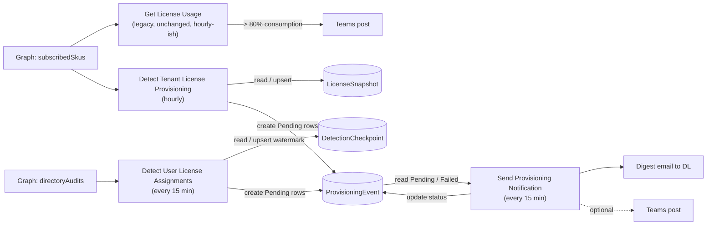

# Microsoft License Provisioning Audit

This repository is structured for **Power Platform ALM best practices**: source-controlled solution components, repeatable build, automated validation, and managed deployment by environment.

## Solution scope

The solution detects provisioning activity and keeps an auditable notification history:

1. Tenant-level license provisioning detection (`subscribedSkus` baseline compare)
2. User-level license assignment detection (`directoryAudits` with overlap + dedupe)
3. Grouped digest notifications with retry tracking
4. Dataverse audit trail (`LicenseSnapshot`, `ProvisioningEvent`, `DetectionCheckpoint`)
5. Least-privilege security roles (`License Audit Reader`, `License Audit Service`) packaged as real solution components

## Flows and how they're linked

There are **4 flows**. None of them call each other directly (no child-flow or HTTP-trigger links between them) — the 3 new flows are deliberately decoupled and only connect through shared Dataverse tables, which act as the single source of truth. This means each flow can be turned on, paused, or re-run independently without breaking the others.



| Flow | Trigger | Reads | Writes | Linked to others via |
|---|---|---|---|---|
| **Get License Usage** (legacy) | Recurrence | Graph `subscribedSkus` | Teams post only (no Dataverse) | Nothing — fully independent, untouched by this project |
| **Detect Tenant License Provisioning** | Recurrence, hourly | Graph `subscribedSkus`; `LicenseSnapshot` (previous values) | Upserts `LicenseSnapshot`; creates `ProvisioningEvent` rows (`Pending`) | Produces rows that **Send Provisioning Notification** later consumes |
| **Detect User License Assignments** | Recurrence, every 15 min | `DetectionCheckpoint` (watermark); Graph `auditLogs/directoryAudits` | Upserts `DetectionCheckpoint`; creates `ProvisioningEvent` rows (`Pending`) | Produces rows that **Send Provisioning Notification** later consumes |
| **Send Provisioning Notification** | Recurrence, every 15 min | `ProvisioningEvent` (`Pending` + `Failed` under retry limit) | Updates `ProvisioningEvent` status/recipient/timestamp/error/flow-run-URL fields | Consumes rows from **both** detector flows |

Key points on the linkage:

- **`ProvisioningEvent` is the only connection point** between the three new flows. The two detector flows never read each other's data (Tenant detector never touches `DetectionCheckpoint`; User detector never touches `LicenseSnapshot`) — they just both append rows to the same audit table.
- **`Send Provisioning Notification` is a pure consumer** — it doesn't know or care which detector created a row, it just polls `ProvisioningEvent` by status.
- This decoupling is intentional: it means a burst of provisioning events from either detector gets digested together by one notifier run, instead of each detector needing its own notification logic.

## ALM implementation in this repo

### 1) Source-first structure

- `src/solutions/microsoft-license-provisioning-audit/` stores unpacked solution source.
- Build artifacts are generated into `out/` and ignored by Git.
- No environment-specific values are hard-coded into source.

### 2) Environment parameterization

Deployment settings files are split by stage:

- `config/deploymentSettings.dev.json`
- `config/deploymentSettings.test.json`
- `config/deploymentSettings.prod.json`

Each file maps:

- Environment variable values
- Connection references

### 3) Automated validation and packaging

Scripts:

- `scripts/validate-solution.ps1`
  - Packs and unpacks to validate source integrity.
- `scripts/build-solution.ps1`
  - Builds both:
    - `microsoft-license-provisioning-audit_unmanaged.zip`
    - `microsoft-license-provisioning-audit_managed.zip`

### 4) CI quality gate

GitHub Actions workflow:

- `.github/workflows/alm-ci.yml`
  - Installs PAC CLI
  - Runs validation
  - Builds managed/unmanaged zips
  - Publishes solution artifacts

### 5) Controlled managed deployment

GitHub Actions workflow:

- `.github/workflows/deploy-managed.yml`
  - Manual promotion to `test` or `prod`
  - Service principal authentication
  - Managed import with environment-specific settings file

## Required GitHub secrets for deployment workflow

Set these repository/environment secrets:

- `PP_APP_ID`
- `PP_CLIENT_SECRET`
- `PP_TENANT_ID`
- `PP_ENV_URL`

## Local build and validation

Run from repo root:

```powershell
./scripts/validate-solution.ps1
./scripts/build-solution.ps1
```

Outputs:

- `out/microsoft-license-provisioning-audit_unmanaged.zip`
- `out/microsoft-license-provisioning-audit_managed.zip`

## Download-ready solution packages

Use these files directly for import:

- `solution-packages/microsoft-license-provisioning-audit_1_1_4_0_unmanaged.zip` (dev/customization)
- `solution-packages/microsoft-license-provisioning-audit_1_1_4_0_managed.zip` (test/prod)

## Step-by-step: create the flows in Power Platform

### 1) Prepare prerequisites

1. In Entra ID, create/register an app for Microsoft Graph.
2. Grant **Application permissions**: `Organization.Read.All` and `AuditLog.Read.All`; grant admin consent.
3. Create a client secret for the app.
4. In Power Platform, ensure Dataverse is enabled in your target environment.
5. Create required connections:
   - Dataverse
   - Office 365 Outlook (service account/shared mailbox)
   - HTTP with Entra ID (or equivalent Graph-authenticated HTTP connector)

### 2) Import the solution

1. Go to **Power Apps -> Solutions -> Import solution**.
2. Import `microsoft-license-provisioning-audit_1_1_4_0_unmanaged.zip` in development.
3. During import, bind connection references to your environment connections.
4. Set environment variable values:
   - `mlpa_TenantID`
   - `mlpa_ClientID`
   - `mlpa_Secret`
   - `mlpa_NotificationDL`
   - `mlpa_PollOverlapMinutes` (default `30`)
   - `mlpa_MaxRetries` (default `3`)
   - `mlpa_EnableTeamsNotification` (`No` by default)
   - `mlpa_GraphBaseUrl` (`https://graph.microsoft.com`)
   - `mlpa_AuthorityUrl` (`https://login.microsoftonline.com`)
   - `mlpa_M365GroupID` (used by the legacy utilization flow)

### 3) Verify Dataverse components

1. Confirm tables exist:
   - `mlpa_LicenseSnapshot`
   - `mlpa_ProvisioningEvent`
   - `mlpa_DetectionCheckpoint`
2. Confirm the two security roles exist (imported automatically as solution components — no manual setup needed):
   - `License Audit Reader` — read-only on the three tables above.
   - `License Audit Service` — read/append/create/write (no delete) on the three tables above; assign this to the connection identity the flows run as.
3. Assign `License Audit Service` to the user/service account whose connection reference the flows use, and `License Audit Reader` to anyone who needs read access to the audit trail.

### 4) Enable flows in the right order

1. Turn on **Detect Tenant License Provisioning** (hourly).
2. Turn on **Detect User License Assignments** (every 15 minutes).
3. Turn on **Send Provisioning Notification** (every 15 minutes).
4. Keep **Get License Usage** enabled only if you still want the legacy 80% utilization alert.

### 5) First-run behavior

1. Tenant detector seeds the `LicenseSnapshot` baseline on first run (no notifications).
2. User detector creates the initial checkpoint baseline on first run (no notifications).
3. Subsequent runs create `ProvisioningEvent` rows with `Pending` status.

### 6) Notification behavior

1. Notifier groups pending events into one digest email to `NotificationDL`.
2. On success, events are marked `Sent`.
3. On failure, events are marked `Failed` and retried up to `MaxRetries`.
4. Optional Teams notification is controlled by `EnableTeamsNotification`.

### 7) Functional test procedure

1. Add a small number of licenses to the tenant (or assign a test license to a user).
2. Wait for detector schedules to run.
3. Confirm new rows in `mlpa_ProvisioningEvent`.
4. Confirm digest email delivery to the distribution list.
5. Confirm each event has updated notification fields (`NotificationStatus`, `NotificationSentOn`, `RetryCount`, `FlowRunUrl`).

## Operational notes

- Existing legacy flow (80% consumption alert) remains in the solution source.
- `mlpa_Secret` exists as an environment variable; production should use Key Vault-backed secret handling.
- Sovereign cloud routing is supported through `GraphBaseUrl` and `AuthorityUrl` variables, but tenant validation is still required.
- Security roles (`License Audit Reader`, `License Audit Service`) are real solution components (`src/solutions/microsoft-license-provisioning-audit/Roles/`) packaged with deterministic, name-based privileges (e.g. `prvReadmlpa_ProvisioningEvent`) scoped to the three audit tables — Dataverse resolves these by name on import, so no environment-specific GUIDs are required. Schema verified against a real Microsoft-shipped solution (CoE Starter Kit); not yet import-tested end-to-end in a live tenant.
- Alternate keys are not used on `mlpa_ProvisioningEvent`/`mlpa_LicenseSnapshot`; duplicate avoidance relies on check-before-create logic in the flows plus serialized runs.
- **Publisher**: the solution ships its own publisher, `License Provisioning Audit` (unique name `MLPAPublisher`), instead of relying on the target environment's auto-generated default publisher. It also uses its own customization prefix (`mlpa`, option value prefix `20541`) instead of reusing `cr3f6` from the environment's default publisher, so there is no risk of a "customization prefix already in use" conflict on import. Every component (tables, fields, choices, flows, roles, connection references, environment variables) was renamed to the `mlpa_` prefix.
